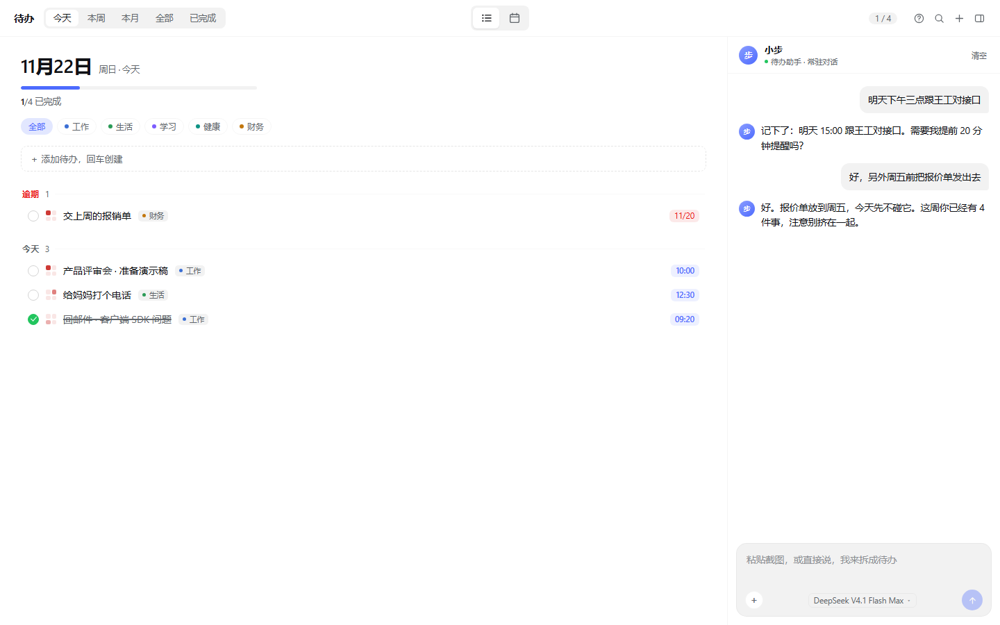

# dsh-plugin-todo

一个 DeepSeek Harness 的待办插件：侧栏多一格入口，点开是**待办清单 + 日历 + 常驻 AI 助手**。

粘贴一张会议截图，它会拆成带日期、标签、优先级的草案；缺的字段标出来，你补完再一键创建。



## 安装

三种方式，任选其一：

**从 GitHub 直接装**（推荐，不用 clone）

```
dsh plugin install lvlvRon/dsh-todos
```

或在 DSH 里 **Plugins → Add plugin**，粘贴 `https://github.com/lvlvRon/dsh-todos`。

**从本地目录装**

```sh
git clone https://github.com/lvlvRon/dsh-todos.git
dsh plugin install ./dsh-todos
```

或在 Plugins → Add plugin 里选择 **仓库根目录**（`dsh-todos/` 本身，不是子目录）。

**装什么**：仓库根就是插件包（`package.json` 里声明了 `dsh.bundle`），`client.js` 是已构建的产物，clone 后**不需要构建就能用**。

安装后侧栏出现「待办」图标（排在「任务」之后）。

## 功能

**列表**
- 默认「今天」，每个待办都带日期（`11/22 10:00`）
- 时间段按范围筛选：**今天**（逾期 + 今天）· **三天内**（今天起 3 天内，含逾期）· **7天内**（7 天内，含逾期）· **以后**（7 天之后 + 未排期）· **已完成**
- 分组：逾期 / 今天 / 本周 / 以后 / 未排期；标签筛选；标题与备注搜索
- 四象限视觉层次：重要+紧急的行更大、带红色左侧条；完成的一律缩到最小
- 临近截止（0–2 天）琥珀色时间标签
- 勾选即完成，删除有 5 秒撤销

**数据备份**
- 顶部 ⇅ 按钮：**导出待办**（含已完成，JSON 文件）与**导入待办**（按 id 合并，已存在的覆盖、不存在的新增）

**编辑**
- 双击行进入行内编辑；改动后必须保存或取消才退出
- 「＋ 添加待办」复用同一套界面

**日历**
- 7×6 网格，农历日 / 二十四节气 / 传统节日 / 生日
- 滚轮翻月、年月选择器、本月回跳；离线历法表覆盖 1900–2100

**AI 助手**
- 真流式输出，支持 Markdown
- 截图或一句话 → 待办草案；分条创建、缺字段留下、已创建打标不重复提交
- 需要决策时给选项按钮，点一下即回答
- **按需查库**（`query_todos` 工具），不把整份清单塞进上下文
- **时间锚点**：每轮注入当前时刻时区，历史消息带时间戳，跨天对话会提示按原消息时间理解

**模型**
- 默认跟随 DSH 默认模型，零配置、无密钥；可单独选模型与思考等级并持久化

## 数据与隐私

待办、对话、设置、重要日期都存在 DSH 存储域（`ctx.storageDomain`），不写工作区文件，插件代码不含任何密钥。只有你要识别的内容会发给模型。

## 结构

仓库根就是插件包：

```
├─ index.js          Host 半：存储域 + HTTP 路由 + SSE + 工具循环
├─ client.js         Client 半：构建产物（单文件，esbuild 打包压缩）
├─ package.json      dsh.bundle.patch + dsh.client{platform:'web'}
├─ cordis.patch.yml  插入到 profile 的 patch 行
├─ src/
│  ├─ index.js       Client 源码：组件、状态、交互
│  └─ styles.css     Client 样式（构建时内联成字符串）
├─ lib/
│  ├─ domain.js      todos / settings / conversation / events 四张表
│  ├─ channel.js     路由封装：JSON、SSE、同源校验
│  ├─ calendar.js    农历查表 + 节气天文算法 + 节日映射
│  └─ chat.js        人设、上下文拼装、工具定义、结构化块解析
├─ data/lunar-table.json   1900–2100 农历表
├─ docs/             插件详情页与设计文档
├─ design/           UI 原型与本地预览（不参与安装）
└─ tools/            农历表生成、asar 检索等开发脚本
```

**为什么 client 要构建**：DSH 的 client 半只有一个产物文件（`__ModuleLoader__.load({factory})`，工厂里的 `require` 只解析浏览器模块表）。所以源码拆开写、构建成单文件。

## 开发

```sh
pnpm i && pnpm build                  # 源码 → client.js
cd tools/lunar-gen && node gen.mjs    # 重新生成并自校验农历表

# 本地预览面板（假数据，渲染同一份 client.js）
# 直接双击 design/harness/index.html
```

## 已知限制

- 法定节假日与调休不标注
- 农历覆盖 1900–2100
- 早期对话消息无时间戳，显示为「时间未知」
- 不支持删除单条消息，只能清空整段对话

## License

MIT。农历表由 [lunar-javascript](https://github.com/6tail/lunar-javascript)（MIT）生成并逐日校验。
